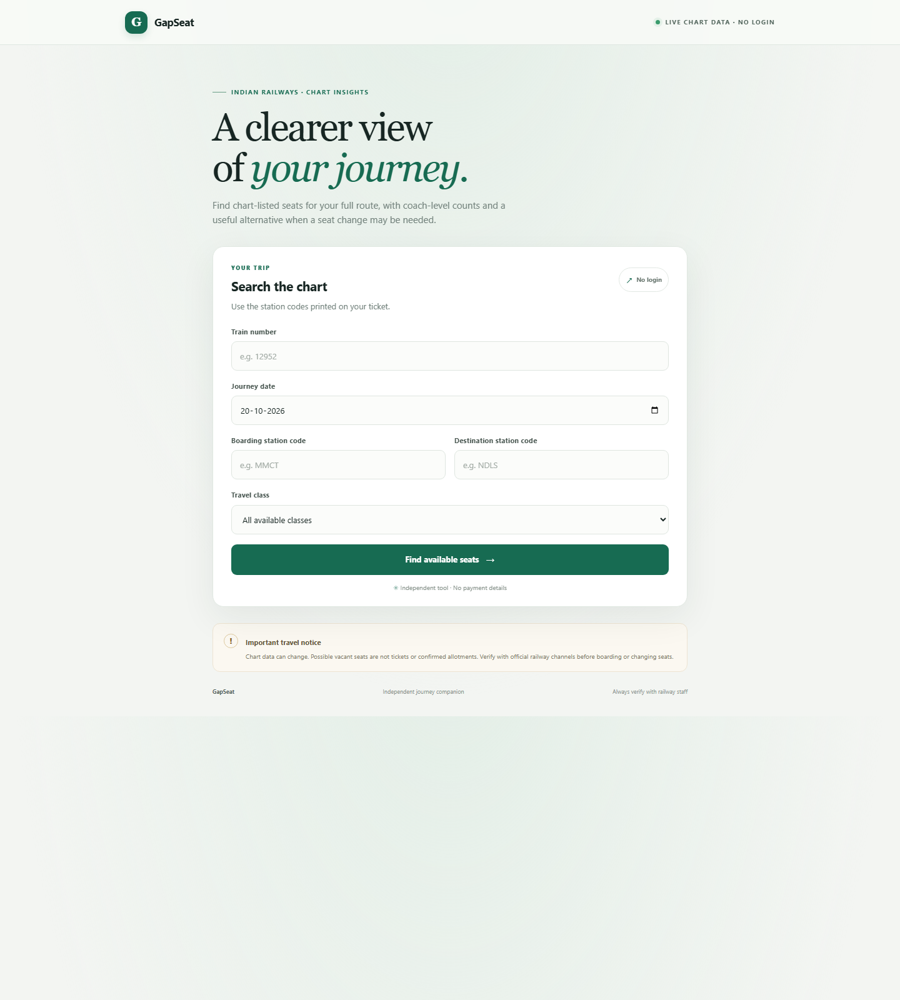

# GapSeat

GapSeat is a web app for checking chart-listed vacant seats and berths for a train journey. Enter a five-digit train number, journey date, boarding and destination station codes, and optionally a travel class. GapSeat retrieves train chart and route data and shows options for the selected journey.

> **Important:** GapSeat is an independent information tool, not a ticketing service. A listed vacancy is not a ticket, reservation, or confirmed allotment. Chart data can change; verify with official railway channels or railway staff before travelling or changing seats.

## Screenshot



## Features

- Responsive interface served by FastAPI.
- Search by train number, journey date, boarding station code, and destination station code.
- Optional travel-class filter.
- Chart-listed seats and berths vacant for the full selected journey, with coach and berth details.
- If no single seat covers the full journey, a possible multi-seat itinerary with a seat change between journey segments.
- Route and journey-order validation, with user-facing errors when data is unavailable.
- No account, payment details, or ticket booking.

## How it works

FastAPI serves the page and static assets. The browser sends searches to the Python `/api/search` endpoint, which gets chart and route data from the client and vacancy filter in `irctc-vacancy-mcp/src`.

```text
Browser (HTML, CSS, JavaScript)
        |
        | POST /api/search
        v
FastAPI (app.py)
        |
        +--> Train chart and route data (irctc-vacancy-mcp/src)
        +--> Vacancy filtering and seat-change itinerary
        |
        v
Chart-listed journey options
```

GitHub stores the source code, but **GitHub Pages cannot run this FastAPI/Python backend**. Deploy the repository as a Python web service; the instructions below use Render to host both the interface and its API.

## Requirements

- Python 3.11 recommended.
- Git for cloning or publishing the project.
- Network access to install the Python packages and retrieve upstream train data.

Dependencies are listed in [`requirements.txt`](requirements.txt).

## Run locally on Windows

Open PowerShell in the project directory and run:

```powershell
cd D:\Projects\GapSeat
py -3.11 -m venv .venv
.\.venv\Scripts\Activate.ps1
python -m pip install --upgrade pip
python -m pip install -r requirements.txt
python -m uvicorn app:app --host 127.0.0.1 --port 8000 --reload
```

Then open <http://127.0.0.1:8000/>. FastAPI's interactive API documentation is available at <http://127.0.0.1:8000/docs>.

If PowerShell blocks virtual-environment activation, use its Python executable directly:

```powershell
.\.venv\Scripts\python.exe -m pip install -r requirements.txt
.\.venv\Scripts\python.exe -m uvicorn app:app --host 127.0.0.1 --port 8000 --reload
```

## Troubleshooting

- **The page loads but search fails:** confirm the Render deployment is Live and check its logs. Search requires the Python backend and access to upstream chart and route services.
- **`ModuleNotFoundError` for `irctc_api` or `vacancy_filter`:** run the app from the repository root and keep `irctc-vacancy-mcp/src` in the published repository.
- **No chart or route data:** the upstream service may be unavailable, may block a request, or may not have chart data for the selected journey. Retry later and verify the train details and station codes.
- **Trying GitHub Pages:** Pages only serves static files. It cannot execute `app.py` or provide `/api/search`; use a Python-capable web host such as Render.

## Project layout

```text
.
├── app.py                       # FastAPI application and search endpoint
├── requirements.txt             # Python dependencies
├── irctc-vacancy-mcp/
│   └── src/
│       ├── irctc_api.py         # Train chart and route API client
│       └── vacancy_filter.py    # Journey vacancy filtering
├── services/                    # Placeholder modules; not used by app.py
├── static/
│   ├── app.js                   # Unreferenced script; browser logic is inline in the template
│   └── style.css                # Page styles
├── templates/
│   └── index.html               # HTML interface
└── screenshots/
    └── gapseat-home.png         # Desktop screenshot
```
